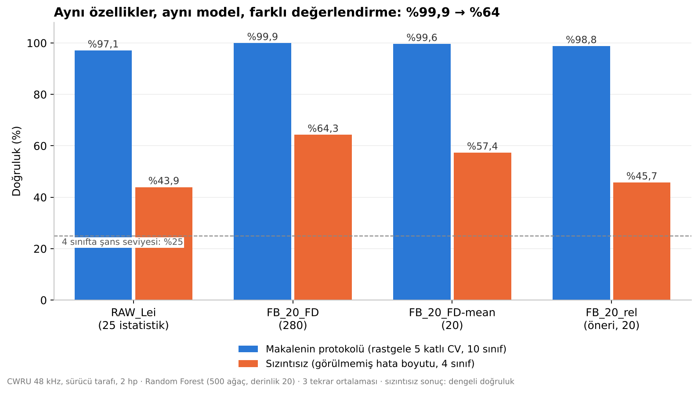
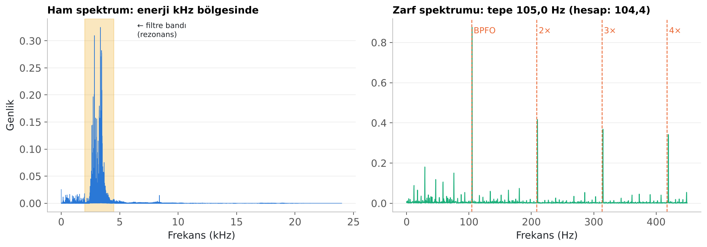

# Rulman Arıza Teşhisinde %99,9 Gerçek mi?

**Alan bilgisiyle özellik mühendisliği üzerine bir makalenin tekrar üretilmesi ve veri sızıntısı testi**

Veri Madenciliği dersi vize çalışması · Erdi Karaboğa · Ekim 2026

---

## Özet

Bienefeld ve ark. (2023, *Entropy* 25:1278), CWRU rulman veri setinde titreşim sinyalinin frekans bantlarından çıkarılan basit özelliklerle Random Forest kullanarak **%99,9'un üzerinde** doğruluk raporluyor ve bu yaklaşımın derin öğrenmeden (CNN, %98,5) daha iyi, daha ucuz ve daha açıklanabilir olduğunu savunuyor.

Bu çalışmada:

1. Makalenin sonucunu gerçek veriyle **birebir tekrar ürettim** (%99,94).
2. Makalenin değerlendirme protokolünde bir **veri sızıntısı** olduğunu gösterdim: her sınıf tek bir kayıttan geliyor ve aynı kaydın parçaları hem eğitim hem test kümesine düşüyor.
3. Sızıntıyı kaldırınca (test edilen rulman eğitimde hiç görülmeyince) doğruluğun **%64'e** düştüğünü ölçtüm.
4. Modelin **arızanın varlığını %100 doğru** bulduğunu, ama **arızanın yerini** (iç bilezik / dış bilezik / bilye) görülmemiş rulmanlarda ayırt **edemediğini** buldum.
5. Kendi önerim olan göreli bant enerjisini test ettim; hipotez **tutmadı** (dürüst negatif sonuç).



## Deneyler ve sonuçlar

| Deney | Ne test ediliyor | FB_20_FD | FB_20_FD-mean | RAW_Lei | FB_20_rel (öneri) |
|---|---|---|---|---|---|
| **D1** | Makalenin protokolü: 2 hp, 10 sınıf, rastgele tabakalı 5 katlı CV | **%99,94** | %99,60 | %97,07 | %98,77 |
| **D1b** | Aynı, ama her kaydın ilk %80'i eğitim, son %20'si test | %100 | %100 | %98,15 | %98,75 |
| **D2** | Sızıntısız: 4 sınıf, bir hata boyutu eğitimde hiç yok (dengeli doğruluk) | **%64,3** | %57,4 | %43,9 | %45,7 |
| **D5** | 2 hp ile eğit, 0 hp (1796 rpm) ile test | %84,6 | %72,1 | %73,9 | %68,9 |

- Random Forest: 500 ağaç, en fazla 20 derinlik; her sonuç 3 farklı rastgele tohumun ortalaması.
- 4 sınıfta şans seviyesi %25'tir.
- D1b'nin yüksek çıkması, sorunun komşu pencerelerin benzerliği değil, **aynı kaydın** hem eğitimde hem testte bulunması olduğunu gösteriyor.

### Arızayı buluyor, yerini bulamıyor

Sızıntısız testte (D2, FB_20_FD) karışıklık matrisi:

| Gerçek ↓ / Tahmin → | Sağlam | İç bilezik | Dış bilezik | Bilye |
|---|---|---|---|---|
| **Sağlam** | **%100** | 0 | 0 | 0 |
| **İç bilezik** | 0 | **%24** | %32 | %44 |
| **Dış bilezik** | 0 | %18 | **%45** | %37 |
| **Bilye** | 0 | %10 | %2 | **%88** |

Hiçbir hasarlı rulman sağlam sanılmadı. Ancak hasarın konumu görülmemiş rulmanlarda büyük ölçüde karıştırıldı.

## Fiziksel doğrulama

Gerçek veride, dış bileziği hasarlı rulmanın zarf spektrumundaki tepe **105,0 Hz**'de çıkıyor. Rulman geometrisinden hesaplanan dış bilezik arıza frekansı (BPFO) **104,4 Hz**.



## Makaleye yönelik eleştiriler

| Eleştiri | Durum |
|---|---|
| Veri sızıntısı: aynı kaydın pencereleri rastgele bölünmüş | Test edildi (D2) |
| Tek yük koşulu: devir değişince bant özellikleri kayıyor | Test edildi (D5) |
| Zarf analizinde bant geçiren filtre belirtilmemiş | Yöntem okumasından |
| PCA öncesi standartlaştırma belirtilmemiş | Yöntem okumasından |
| Açıklanabilirlik yalnızca Random Forest önemine (MDI) dayalı | Yöntem okumasından |

Makalenin **göreli** sonucu (frekans bantlarının istatistiksel özelliklerden iyi olması) sızıntısız testte de korunuyor; sorgulanan, **mutlak** doğruluk rakamı.

## Klasör yapısı

```
rulman-ariza-teshisi/
├── README.md
├── requirements.txt
├── veri_indir.sh          # CWRU verisini data/ klasörüne indirir
├── kod/
│   ├── cwru_deney.py      # Tüm deneyler (D1, D1b, D2, D3, D5)
│   └── sekiller.py        # Sunumdaki grafikler
├── sonuclar/
│   └── sonuclar.json      # Ham sonuçlar ve karışıklık matrisleri
├── sekiller/              # 7 grafik (PNG)
└── sunum/
    └── Rulman_Vize_Sunumu.pptx
```

## Tekrar çalıştırma

```bash
git clone https://github.com/<kullanici-adin>/rulman-ariza-teshisi.git
cd rulman-ariza-teshisi
pip install -r requirements.txt
./veri_indir.sh                         # ~380 MB, git gerekir
python3 kod/cwru_deney.py               # ~4 dk; sonuclar/sonuclar.json üretir
python3 kod/sekiller.py data/CWRU-dataset
```

Ham veri boyutu nedeniyle depoya eklenmedi; `veri_indir.sh` ile indirilir.

## Sınırlamalar

- D1 (10 sınıf) ile D2 (4 sınıf) birebir aynı görev değildir; ancak D2 daha kolay bir görev olmasına rağmen doğruluk düşmüştür.
- Veri setinde tek bir sağlam rulman kaydı olduğu için sağlam sınıfında zamansal bölme (ilk %70 / son %30) kullanılmıştır; sağlam sınıfındaki %100 bu nedenle iyimser olabilir.
- Makaledeki EMD, wavelet ve zarf özellik setleri tekrar üretilmemiştir.
- F13 frekans özelliğinde negatif sayının karekökü oluşmaması için mutlak değer kullanılmıştır (makalede belirtilmemiş).

## Kaynaklar

1. Bienefeld C., Becker-Dombrowsky F.M., Shatri E., Kirchner E. *Investigation of Feature Engineering Methods for Domain-Knowledge-Assisted Bearing Fault Diagnosis.* Entropy 25(9):1278, 2023. https://doi.org/10.3390/e25091278
2. Hendriks J., Dumond P., Knox D.A. *Towards better benchmarking using the CWRU bearing fault dataset.* Mechanical Systems and Signal Processing 169:108732, 2022. https://doi.org/10.1016/j.ymssp.2021.108732
3. Smith W.A., Randall R.B. *Rolling element bearing diagnostics using the Case Western Reserve University data: A benchmark study.* MSSP 64–65:100–131, 2015.
4. Randall R.B., Antoni J. *Rolling element bearing diagnostics — A tutorial.* MSSP 25:485–520, 2011.
5. Case Western Reserve University Bearing Data Center. https://engineering.case.edu/bearingdatacenter
